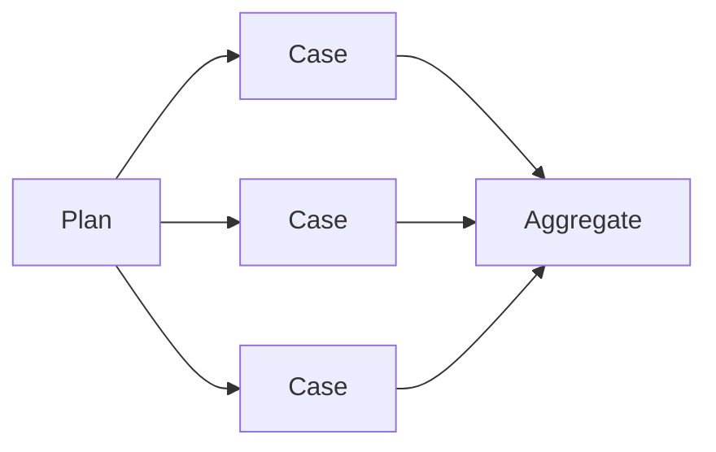

## Context

Currently, the fullsend runner captures the agent's console in-process, filters it, and forwards it to the run directory. That is fragile and redundant:

- fullsend's console format is explicitly not a contract ([fullsend ADR 0050](https://github.com/fullsend-ai/fullsend/blob/main/docs/ADRs/0050-distributed-tracing-instrumentation.md)), yet the harness parses it.
- The harness duplicates log processing the CI platform already performs for every job.
- A single CI job shares one console, timeout, and failure domain across the whole suite.

[Issue #332](https://github.com/fullsend-ai/agent-eval-harness/issues/332) proposes one CI job per case. The [follow-up comment](https://github.com/fullsend-ai/agent-eval-harness/issues/332#issuecomment-7010989491) sets the harness shape: deterministic, platform-neutral **plan / case / aggregate** CLIs; a plan file carrying the run ID and case list; a case command that runs or reruns one case independently, runner-neutral; no LLM orchestration and no CI API assumptions in the core.

All runners support the proposed plan/case/aggregate path for case mode; batch stays batch. Non-Fullsend runners keep their existing case/batch modes and case-mode `--parallelism` unchanged.

## Decision



Proposed CLIs — **none exist yet; names and flags are illustrative**:

```text
agent-eval-ci plan      --config eval.yaml --out plan.json
agent-eval-ci case      --plan plan.json --case <id> [--run-dir <dir>]
agent-eval-ci aggregate --plan plan.json --run-id <id> [--logs <dir>]
```

Run-dir resolution always goes through [#325](https://github.com/fullsend-ai/agent-eval-harness/pull/325)'s shared resolver. Each runner keeps its existing results channel; the case command maps it in-process (see [Fullsend](#fullsend)).

### Plan

`plan` resolves refs, mints the run ID, and uses the existing workspace staging path to prepare the selected cases before running `before_all` with that ID. It writes a plan file (run ID, case list, resolved refs). `before_all` outputs are not shared with case jobs for now; credentials needed by case jobs must be supplied separately. Slices and fetched logs are access-protected.

### Case

`case` runs one case independently and rerunnably through the existing execution path — `execute.py` and the configured runner — preserving timeout and exit-code semantics. It materializes the case workspace, runs `before_each`, `before_step`/`after_step` around each step invocation and `after_each` at the end — including when the case fails — sequenced by the harness. Case jobs require isolated filesystems and checkouts to avoid collisions between workspaces and run directories. Results are mapped in-process from the runner's results channel to `run_result.json` / `stdout.log`, and `hook_outputs.yaml` and step evidence are written. The slice is the **complete executed case workspace** — including `.git`, hidden, tracked-modified and new files — plus results files and `subagents/` when events are collected. An `after_each` failure affects the case's final status according to its configured policy, and failed or missing cases propagate to CI: an aggregate job that always runs must not turn the run green.

### Aggregation

`aggregate` restores the collector's view — `<workspace>/cases/<id>/` from each slice, `case_order.yaml` from the plan, hook/step evidence, and the run-root `run_result.json` from the case slices — then runs `collect.py`, `score.py`, and `report.py` unchanged. A selected case with no slice keeps its entry and is recorded as lost evidence. For Fullsend, it also accepts job logs for provenance (see [Fullsend](#fullsend)).

### Hooks

| Phase | Job |
| --- | --- |
| `before_all` | plan, once |
| `before_each` / `after_each`, `before_step` / `after_step` | case |
| `after_all` | aggregate, after assembly, before collect/score |
| `before_scoring` / `before_report` | unchanged in `score.py` / `report.py` |

`after_all`'s continue-on-failure semantics depend on the platform scheduling the aggregate job after failed case jobs. Hooks needing a shared process or workspace across cases (fake API server, port-forward, minted credential) don't port: they become per-case hooks or CI setup steps.

### Provenance (runner-neutral)

Version probes run per case and land in that case's `run_result.json`; `aggregate` unions them and reports drift — across cases and across invocations within a case. Fullsend's observed sandbox image/arch is Fullsend-specific (see [Fullsend](#fullsend)).

### Fullsend

- **Runner reuse and mapping.** The case command reuses `execute.py`/`FullsendRunner` to launch Fullsend with an **inherited console** — no capture, filtering or forwarding — and maps its run directory in-process with the existing mapper, which is console-independent. Fullsend is responsible for redacting secrets at the source; leaks must be fixed upstream, not filtered by the harness — this matches production.
- **Temporary log provenance.** Fullsend's observed sandbox image and arch come from job logs the CI workflow fetches — platform-processed, **completed** — and passes as **files** to `aggregate`, which parses them in the harness (GitHub job-log endpoint with `actions: read`; GitLab job trace with a `read_api` token, not the unverified `CI_JOB_TOKEN`). GitHub timestamps are stripped before parsing. No log supplied or image found → harness-file image with attribution; arch is unset if not observed. A failed requested fetch → unresolved, with an error naming the case. Non-Fullsend runners need no logs for provenance. Once reliable structured image/arch provenance exists, single-case and batch runs can have complete provenance in one job; [fullsend#9013](https://github.com/fullsend-ai/fullsend/issues/9013) proposes structured events but promises no fields.
- **Capture removal and parallelism.** Once the CI path reaches parity, the old Fullsend console capture/filter/forwarding is removed — for batch as well as case — and CI fan-out (matrix concurrency, per-case job timeouts) replaces Fullsend's in-process `--parallelism`. Each Fullsend case's console is then the CI job log: live, unfiltered, isolated per case, replacing its captured `stderr.log`.
- **Batch.** Fullsend batch remains single-invocation with its existing output mapping, but loses the captured `stderr.log` (the job or local console is the record); judges that read it lose their input, and identical scores are not claimed for them.

### CI topology (illustrative — workflows are maintainer-authored)

- **GitHub Actions**: plan job publishes plan and matrix (fail-fast disabled); case jobs upload slices as artifacts; aggregate `if: always()`.
- **GitLab CI**: plan publishes `plan.json`; a dynamic child pipeline fans out case jobs; aggregate `when: always`.
- **Prow**: one Eval custom resource per case, a controller running and tracking them — illustrative proposal, no Prow APIs assumed.

### Parity gate

Before deleting Fullsend capture: case-hook-data and step-scoped judges produce identical results from assembled slices vs the in-process path, excluding `before_all` outputs which are not shared; tracked edits and new files outside the output paths are detected after reassembly; partial and missing slices do not lose case records; Fullsend batch scores match the in-process path except judges that depend on the removed `stderr.log`.

## Sequencing

1. **[#325](https://github.com/fullsend-ai/agent-eval-harness/pull/325) lands first** — everything resolves run dirs through its single resolver.
2. **Refactor the execution path** so the suite loop and hook placement split across plan/case/aggregate — the case command reuses the existing execution/runner path, runnable and parity-testable on today's path.
3. **Assembler / aggregate CLI**, tested on fabricated slices including timed-out, partial, and missing slices.
4. **Plan / case CLIs**, then maintainer-authored CI workflows, running alongside the capturing runner.
5. **Delete the old Fullsend capture/filter/forwarding** once the [parity gate](#parity-gate) passes.

## Alternatives considered

- **Use batch mode instead of per-case jobs.** Batch remains supported, but it maps outputs by position rather than `strat_id`, cannot attribute cost per case ([#306](https://github.com/fullsend-ai/agent-eval-harness/issues/306)), and shares a console, timeout, and failure domain. Per-case jobs address those limits.
- **Keep the capturing runner, improve the filter.** Rejected: an unstable format to parse ([fullsend ADR 0050](https://github.com/fullsend-ai/fullsend/blob/main/docs/ADRs/0050-distributed-tracing-instrumentation.md)), and a second implementation of log processing that only the platform maintains.

## Consequences

- Non-Fullsend runners keep their existing case/batch modes and case-mode `--parallelism`.
- Hooks relying on shared process/workspace state must be rewritten per-case; the hooks reference should say so when the CI path ships.
- The provenance union surfaces version drift the in-process path would have reported as uniform.
- Fullsend-specific consequences are listed in the [Fullsend](#fullsend) section.
