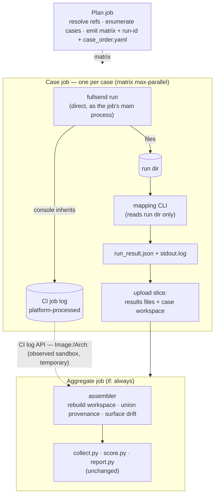

## Context

Issue #332 proposes replacing the fullsend runner's console capture with a CI fan-out: a plan job (resolve refs, enumerate cases, emit the matrix and a shared run-id), one case job per case that invokes `fullsend run` directly, as production does, and an aggregate job that assembles the per-case run-dir slices into `runs/<suite>/<run_id>/cases/<id>/` and runs `collect.py`, `score.py` and `report.py` unchanged (the case-job artifact contract below says what makes that possible for `collect.py`). The issue explains the motivation and the triage notes on it cover the sequencing against the existing runner. This ADR does not repeat them. It records the decisions the issue leaves open: where the lifecycle hooks run, where provenance comes from once nothing captures the console, which runners the topology covers, why harness batch mode is not the answer, and the order of the work.

Scope stays as the issue sets it: case mode only. Batch-mode suites keep the current path.

## Decision

Adopt the plan / case / aggregate topology from the issue, with the following decisions.

### Hooks

Each phase in `agent_eval/hooks.py` maps to exactly one job, at the same position in the pipeline that it has today.

| Phase | Job | Notes |
| --- | --- | --- |
| `before_all` | plan, once | Its `env` and `data` outputs reach case jobs through the same channel that carries the run-id and the case list (job outputs on GitHub, dotenv artifacts on GitLab). Each case job merges them under its `before_each` outputs as `execute.py` does today: global first, case overrides. |
| `before_each` / `after_each` | case | Unchanged. They already run per case, with the case workspace as cwd. |
| `before_step` / `after_step` | case | Unchanged. Multi-step execution happens inside one case. |
| `after_all` | aggregate, once, after assembly | Today `after_all` runs at the end of `execute.py`, after the last case and before `collect.py` and `score.py`. The aggregate job keeps that order: assemble, then `after_all`, then collect and score. The aggregate job runs even when case jobs fail (`if: always()` / `when: always`), so `after_all` keeps its guaranteed, continue-on-failure semantics. |
| `before_scoring` / `before_report` | aggregate | Unchanged. They already live in `score.py` and `report.py`. |

Some hooks don't port: a hook that mutates a shared in-process workspace, or that starts a long-lived process (a fake API server, a port-forward) for the cases to use. The plan job's filesystem and processes are gone before any case job starts. Such hooks become `before_each`/`after_each` hooks, or setup steps (or service containers) in the case job template. A `before_all` that mints a credential is in the same position. GitHub refuses to pass a job output that contains a masked secret (the output is skipped with a warning), and job outputs are size-limited. The credential is therefore minted per case or provided as a workflow secret, not handed across jobs.

### Case-job artifact contract

`collect.py` in case mode is not satisfied by a run directory alone. It requires `--workspace`, exits with an error when `workspace/cases/` is absent, scans each case workspace for the configured `outputs` and for modified files, and reads `case_order.yaml` from the workspace root to know which cases were selected. The aggregate job therefore cannot run it "unchanged" on result files alone. Each case job uploads, as its slice:

- the results files (`run_result.json`, `stdout.log`) — the same shape for every runner. Fullsend produces them from the run directory through the mapping CLI; runners without a run directory (claude-code, codex) emit them from the structured stdout their runner captures, with no mapping step.
- the complete executed case workspace, so the collector sees the same tree it sees today. If the full tree is too large to ship, the minimum slice is exactly:
  - the files matching the configured `outputs` paths;
  - the case's `.git` with its baseline commit (without it, modified-file detection silently returns nothing);
  - the working-tree contents of every file that detection would report (`.git` holds the baseline, not the edits — an edited tracked file left out looks deleted and is dropped; a new untracked file left out is never listed);
  - `subagents/` when events are collected (merged into `events.json`; a harness directory, so never an `outputs` match or a modified file).

  The assembler keeps `.git`, the modified and new files, and `subagents/` when it rebuilds `<workspace>/cases/<id>/`; a parity test covers tracked edits and new files outside the output paths.
- nothing else is needed for `case_order.yaml`: the plan job writes it once and publishes it alongside the matrix and run-id.

Before it invokes the collector, the assembler reconstructs a workspace tree: `<workspace>/cases/<id>/` from each case's workspace slice, and `<workspace>/case_order.yaml` from the plan job's copy. It then calls `collect.py --workspace <workspace>` with no change to the collector. A selected case whose slice is missing keeps its entry in `case_order.yaml` with no workspace directory under `cases/`, so the collector records it as lost evidence (as it does today for a missing case workspace) instead of dropping it. If the slice upload turns out to be too large or too sensitive to ship, the alternative is a different collection stage that reads the configured output paths from per-case artifacts directly. That would be a collector change, to be decided in its own ADR, and not an unchanged collector.

### Provenance

`provenance()` in `agent_eval/agent/fullsend.py` currently probes the local binaries and parses the captured console in the same process. In the new topology the work splits across jobs:

- **Version probes in the case job.** `fullsend_version`, `openshell_version` and `agent_harness_commit` are probed in each case job, the job that actually runs the binary, and written into that case's `run_result.json` `eval_params` by the mapping CLI.
- **Union in the assembler, with drift visible.** If all slices agree, the run-level value is that value. If they differ (for example, a runner image rolled mid-run), the assembler keeps each case's value, warns with the cases named, and reports the drift. It does not pick one value. Mixed versions within one run are a validity concern for the eval, not noise to smooth over.
- **Observed `sandbox_image` / `sandbox_arch` from the CI job log.** The aggregate job fetches each case job's processed log through the CI log API and applies the existing `parse_sandbox_image` (`Image:` / `Arch:` lines) to the fetched text:
  - GitHub: `GET /repos/{owner}/{repo}/actions/jobs/{job_id}/logs`, with `GITHUB_TOKEN` granted `actions: read`. The aggregate job finds the job ids by listing the workflow run's jobs and matching the matrix job names.
  - GitLab: `GET /projects/:id/jobs/:job_id/trace`, with a `read_api` project access token supplied to the aggregate job as a masked CI/CD variable; job ids come from listing the pipeline's jobs (`GET /projects/:id/pipelines/:pipeline_id/jobs`). The default `CI_JOB_TOKEN` is not relied on — its authorization for these endpoints is unverified, and using it would need the supported GitLab version and job-token allowlist confirmed first.
  - Failures are surfaced, not hidden. An authorization failure, a missing job, or an expired log on either platform is an error that names the case and the HTTP status, and the run's provenance records the image as unresolved. It is not treated as a log with no `Image:` line.

  The authentication glue is platform-specific and the parsing is shared. One normalisation is needed: GitHub prefixes every log line with an ISO-8601 timestamp, and `_IMAGE_LINE_RE` / `_ARCH_LINE_RE` only allow non-word characters before the label, so the prefix is stripped before parsing. `Image:` lines survive GitHub's `***` masking because they are not secrets. GitLab's trace is the raw console, subject only to masked CI/CD variables. `sandbox_image_source` stays `fullsend-output` (the text is fullsend's console, read from a different place), and the harness-file fallback applies only when the log was fetched successfully and contains no `Image:` line.
- **The log fetch is temporary.** Once fullsend writes the sandbox image and arch into the run directory (the companion ask to fullsend#9013), the run directory becomes the preferred source and the log fetch retires.

### Runner scoping

The matrix and the assembler are runner-agnostic, and console capture is removed for every runner, not just fullsend. Runners differ only in the results channel:

- **fullsend**: the case job inherits the console into the job log and reads results from the run directory through the mapping CLI.
- **Runners without a run directory** (claude-code's stream-json on stdout, codex's `--json`): the case job collects results from the invocation's structured stdout, which plays the run directory's role. The human console (stderr) inherits to the job log, optionally tee'd to a per-case file. This is what production's `run-claude.sh` already does.

The fullsend runner is the only one that interposes on a console today; the others already collect their results from structured output (or API responses) with no console processing to remove. For them the topology is an opt-in benefit — isolation, per-case timeouts and logs — with no runner change beyond the optional stderr inheritance noted above.

Each runner therefore contributes one file-reading "results → `run_result.json`" step. Nothing in the plan or aggregate job depends on which runner produced a slice.

### Sequencing

This refines the triage note (keep the capturing runner until the CI path reaches parity):

1. #325 lands first. The assembler and the aggregate job resolve `runs/<suite>/<run_id>` through its single resolver (`--run-dir`, `scripts/discover.py`) instead of deriving the path themselves.
2. The mapping CLI (`_map_run_dir` as a file-reading command that emits `run_result.json` and `stdout.log`) lands before the assembler. The capturing runner can call it too, which makes parity testable on today's path before any CI change.
3. The assembler comes next, tested on fabricated slices, including a timed-out or partial case and a missing slice.
4. The CI workflow (plan, case, aggregate) is added and runs alongside the capturing runner. Workflow files are maintainer-authored.
5. The capture, filtering and forwarding layer is deleted once the CI path has reached parity.

## Alternatives considered

### One batch invocation per suite (harness batch mode)

Production's fleet jobs run one agent invocation that loops over every strategy, so batch mode looks like the closest match to production. It is rejected for two reasons:

- **Output mapping.** Batch mode assigns output files to cases with `outputs[].batch_pattern`, where `{n}` is the 1-based position in `batch.yaml`. Production keys its outputs by `strat_id`. A positional mapping silently misattributes outputs when the agent skips, reorders, or fails an entry. Fixing that means adding id-keyed mapping to the collector, and that problem is separate from the one this ADR solves.
- **Per-case cost attribution.** A batch records one invocation cost. As #306 describes, per-case cost is then unmeasurable, and a per-case cost judge evaluates the batch total instead. Per-case jobs measure each case's cost directly.

Batch mode also brings back the single shared console, timeout and failure domain that the issue sets out to remove. It stays supported for suites that are inherently batch, but it is not the path for case-mode fullsend evals.

### Keep the capturing runner and improve the filter

The issue argues against this: the console format is explicitly not a contract (fullsend's ADR 0050), and judges never read the console. Not repeated here.

A harness-side filter also re-implements log processing the CI platform already performs for every job. Two implementations of the same platform behavior must be kept in step, and only the platform maintains its own. Delegating console processing to the CI — the path production jobs already take — leaves one implementation.

The alternative is therefore rejected on two grounds: an unstable format to parse, and a platform behavior duplicated.

## Consequences

- Each case's job log is its console: live, unfiltered, isolated per case in the CI UI. The harness no longer tracks fullsend's console shapes, and the `stderr.log` artifact is replaced by the CI job log as the console of record (runners whose console is stderr may still tee it per case, per Runner scoping).
- Parallelism and timeouts become CI concerns: matrix concurrency replaces `--parallelism`, and per-case job timeouts replace the shared run budget. Platform limits apply. GitHub caps a matrix at 256 jobs, so larger suites need chunking in the plan job, and every case job pays runner startup and tool installation.
- Provenance for `sandbox_image` depends on CI log access (a token scope and log retention) until fullsend writes it into the run directory. A local run without capture has no console to parse, so it falls back to the harness-file image (`sandbox_image_source: harness-file`) until then.
- Hooks that relied on a shared process or workspace across cases must be rewritten as per-case hooks or CI setup steps. This should be called out in the hooks reference when the CI path ships.
- The provenance union surfaces version drift between case jobs instead of hiding it, which can flag runs that the in-process path would have reported as uniform.
