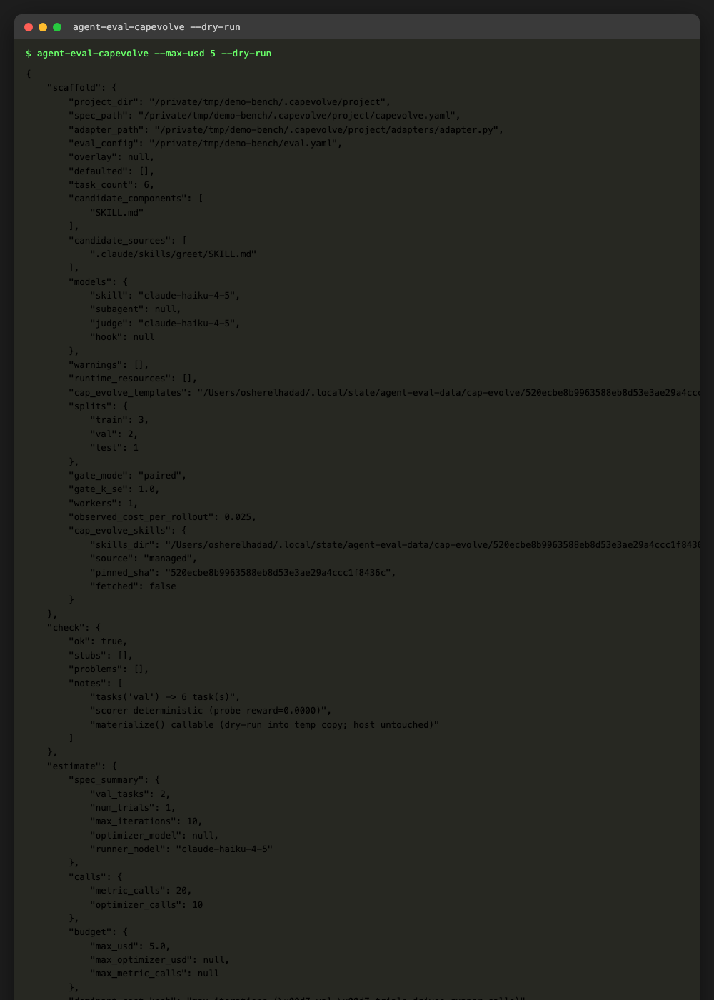
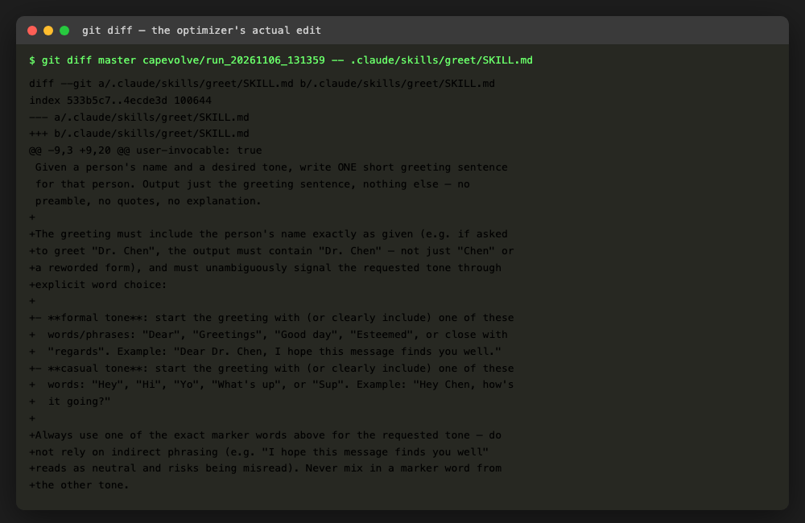
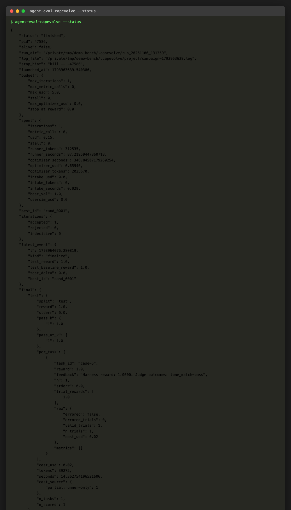
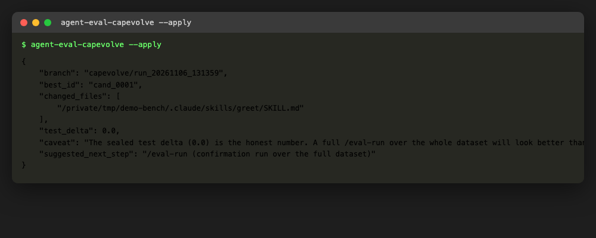
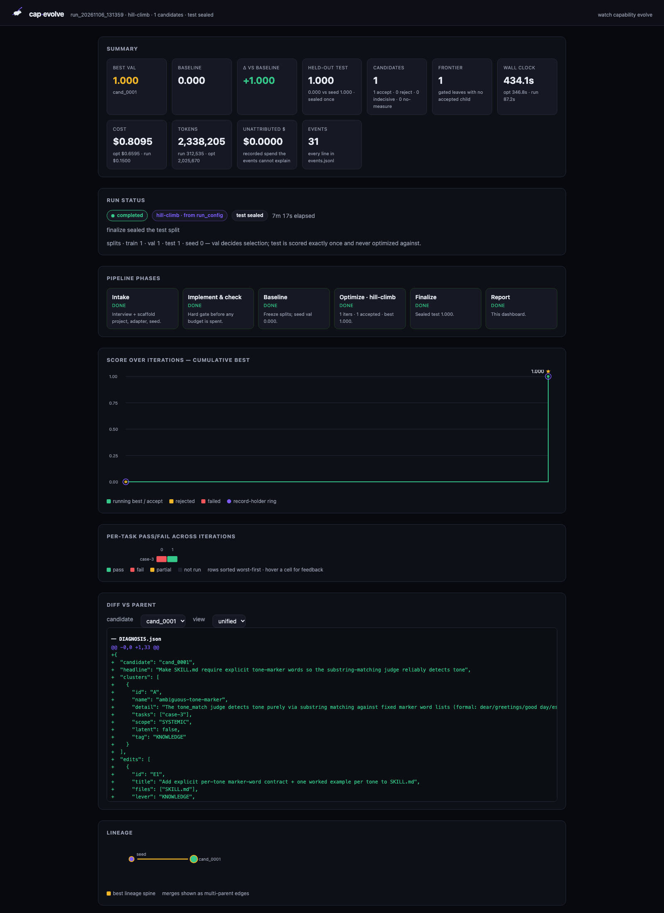

# Statistically validated optimization (cap-evolve)

Pass `--engine cap-evolve` to `/eval-optimize` to use
[cap-evolve](https://github.com/skillberry-ai/cap-evolve) instead of the default
interactive loop: a train/val/test split, a significance gate on val, and a sealed
test score computed exactly once. This is the harness's recommended optimization
path for anything you'd act on — prefer it over the default loop (documented at
[Optimize a skill](eval-optimize.md)) once it's worth the one-time setup.

!!! abstract "Why this instead of the interactive loop"
    The interactive `/eval-optimize` loop edits a skill, re-runs, and reports whether
    judges pass — on however many cases you give it, with no protection against
    noise or overfitting. cap-evolve splits your dataset, evaluates a candidate edit
    on a held-out validation split, and accepts it only when the improvement clears
    `k_se` standard errors — a change too small to trust comes back **indecisive**,
    not "improved" or "regressed". The sealed test split is scored once, at the end,
    so the number you report was never visible during the search.

Everything on this page — every command, every number, every screenshot — comes
from one real campaign run against a small toy skill while writing this guide.
Nothing here is simulated.

## What actually happens, in plain words

Think of it like this: you have a skill (a prompt, a SKILL.md, a small tool) and
some test cases with a pass/fail judge. The interactive loop is a human watching an
intern edit and re-test, one case at a time, trusting their gut on whether it got
better. cap-evolve is the same intern, except:

1. It never looks at a third of your cases (the **test** split) until the very end.
2. It only keeps an edit if the improvement on the cases it *can* see (the **val**
   split) is bigger than what you'd expect from noise alone.
3. At the end, it scores the winner on the cases it never saw, once, and tells you
   honestly whether that held up.

That's the whole idea. The rest of this page is the mechanics and a real example.

## Install

```bash
/eval-setup --optimize
```

This installs `cap-evolve-core` into the harness's own venv and fetches its skills
tree (phases, algorithms, templates) at a pinned commit — nothing to check out
yourself. Needs Python 3.11+ in the harness venv; `/eval-setup --optimize` rebuilds
it with a newer interpreter if needed.

## A real end-to-end example

Here's a deliberately tiny, real benchmark: a `greet` skill that writes one
greeting sentence in a requested tone (formal or casual), and a judge that checks
whether the output actually reads as that tone. Six test cases, a 3/2/1
train/val/test split. Nothing about this example is staged — the seed skill was
genuinely imperfect, cap-evolve genuinely found and fixed the gap, and the numbers
below are copy-pasted from the real run.

The eval config:

```yaml
name: greet-eval
execution:
  mode: case
  skill: greet
  arguments: "{prompt}"
runner:
  type: claude-code
models:
  skill: claude-haiku-4-5
  judge: claude-haiku-4-5
dataset:
  path: eval/dataset/cases
judges:
  - name: tone_match
    description: Does the greeting match the requested tone (formal vs casual)?
    check: |
      ann = outputs.get("annotations", {})
      tone, name = ann["tone"], ann["name"]
      text = outputs.get("stdout", "").strip().lower()
      # ... checks the name appears and the right tone-marker words are used
reward:
  judge: tone_match
optimize:
  candidate:
    - {dest: SKILL.md, source: .claude/skills/greet/SKILL.md}
  apply_to: .claude/skills/greet
```

### Step 1 — `--dry-run`: see the plan before spending anything

```bash
agent-eval-capevolve --max-usd 5 --dry-run
```



This mines the benchmark — the skill, the dataset, the judges — and tells you
exactly what a real campaign would do: a 3/2/1 split, one candidate component
(`SKILL.md`), the models each rollout will use, and a cost estimate. No spend yet,
and your `eval.yaml` is never touched (missing `optimize:`/`reward:` blocks get
proposed into a separate `.capevolve/eval.optimize.yaml` overlay instead).

### Step 2 — launch a real campaign

```bash
agent-eval-capevolve --max-usd 5 --max-iterations 1 --num-trials 1 \
  --pilot-case-ids case-1 case-3 case-5 --run
```

(`--pilot-case-ids` pins one case per split for a fast, cheap sanity run — the
normal path is just `--max-usd 25` with no pilot flags, over the real split sizes.
The pilot run above is what actually produced every screenshot on this page.)

The campaign runs **detached** — it survives you closing the terminal — and
launches the real pipeline: scaffold the project, probe the seed skill on train and
val, hand the failing case to a real coding agent (`claude-code`, by default) as
the optimizer, score its candidate, and — only if it clears the significance gate —
accept it and move to the sealed test.

In our run, the seed skill passed the train case but **failed the val case**: asked
to greet "Dr. Chen" formally, it wrote *"I hope this message finds you well, Dr.
Chen"* — stylistically formal, but with no word the judge's substring check
recognized as a formal marker (and, amusingly, the word "you" contains "yo", which
the judge's own casual-marker list matched — a bug the optimizer later diagnosed in
its own write-up).

### Step 3 — the optimizer reads the failure and proposes a fix

This is the part that's easy to under-explain: a real `claude-code` subprocess
reads the failing case's full feedback (reward, judge outcomes, the harness's
explanation of what's being optimized) and edits `SKILL.md` directly. Here is the
**exact diff it produced**, unedited:



It correctly diagnosed that the judge checks for specific marker words ("Dear",
"Greetings", "Hey", "Hi", ...) and taught the skill to use them explicitly, with a
worked example per tone — a generalizable rule, not a hack for the one failing
case. This candidate then re-ran on the val split and scored a perfect 1.0, clearing
the significance gate, so cap-evolve accepted it.

### Step 4 — `--status`: what happened, honestly

```bash
agent-eval-capevolve --status
```



`best_id: cand_0001`, one accepted iteration, `best_val: 1.0` versus the seed's
`0.0` on val. The sealed test case scored 1.0 for **both** the winner and the seed
baseline in this particular pilot run — with only one test case, that's expected
variance, not a contradiction; the honest caveat text (see Step 5) says so plainly.
A full campaign with real split sizes would use more test cases and resolve this
kind of coin-flip.

### Step 5 — `--apply`: land the winner on a branch

```bash
agent-eval-capevolve --apply
```



This copies the winning `SKILL.md` onto a new `capevolve/run_<id>` git branch and
returns you to your original branch — it never commits to your current branch
directly. The `caveat` field is cap-evolve's own honesty check: it tells you how
many of your total cases were actually seen during the search (train + val), since
a full `/eval-run` over the whole dataset will look *better* than the sealed test
delta for exactly that reason.

### The dashboard

A launched campaign writes its own run directory under `.capevolve/run_<timestamp>/`
— including a **self-contained `dashboard.html`** you can open directly, no backend
needed (a live-updating version is also available via `pip install -e
<cap-evolve checkout>/dashboard/backend && cap-evolve dashboard --base .capevolve`
if you want to watch a long campaign progress in real time).

Here's the real dashboard from the run above:



Reading it left to right, top to bottom:

- **Summary row** — best val (1.000) vs. baseline (0.000), the delta, the sealed
  test score, candidate/iteration counts, wall-clock, and total spend ($0.81 for
  this whole pilot — mostly the optimizer agent's own tokens, not the skill's).
- **Pipeline phases** — intake → implement & check → baseline → optimize →
  finalize → report, each marked done with a one-line summary. This is the exact
  sequence described above, laid out as a timeline.
- **Score over iterations** — the cumulative-best line. Flat at 0 until the one
  accepted candidate, then a jump to 1.0 — a real, measured step, not a smoothed
  curve.
- **Per-task pass/fail** — a grid of every task × outcome. With one val case this
  is a single row; a real campaign's grid is where you'd spot a task that's
  always failing versus one that flips with noise.
- **Diff vs parent** — the optimizer's own structured diagnosis
  (`DIAGNOSIS.json`), generated automatically alongside the SKILL.md edit, naming
  the failure cluster and the fix.
- **Lineage** — seed → accepted candidate, as a small graph. On a longer campaign
  with several iterations this is where you'd see rejected branches dead-end and
  the accepted lineage continue.

## What this is actually for

Reach for `--engine cap-evolve` instead of the interactive loop when:

- You're about to **act on the result** — ship a prompt change, hand a skill to
  other people, report a number to someone — and being wrong costs more than the
  campaign does.
- Your dataset is big enough to split three ways and still have a meaningful val
  size (the honesty note in `--status`/`--apply` tells you plainly when it isn't:
  with `val < 2` the gate degrades to "any positive delta is accepted", which is a
  coin flip, not a measurement).
- You want a **paper-trail**: every accepted/rejected candidate, its diff, and why,
  recorded in the run directory — useful when someone asks "why did the skill
  change" six months later.

Stick with the interactive `/eval-optimize` loop when you're iterating quickly on a
handful of cases and just want a fast, good-enough fix — the statistical machinery
is overhead you don't need yet.

## Substrates

| `--runner` | What runs | When to use it |
| --- | --- | --- |
| `local` (default) | Each rollout's workspace is staged and executed the same way `/eval-run` does, locally | Most benchmarks |
| `harbor` | Each rollout becomes a private, self-contained Harbor task package (`--env podman\|kubernetes`, `--image `) | Containerized isolation, or an existing Harbor setup |

`--runner evalhub` is refused — EvalHub's architecture doesn't support cap-evolve's
per-rollout fan-out.

## Cost control

`--max-usd` is the campaign's hard total (optimizer + runner spend combined).
`--runner-budget-usd` additionally caps what a *single* rollout may spend — useful if
one case is prone to runaway tool-call loops. `--dry-run` gives you a cost-per-rollout
estimate, calibrated from this eval's own past runs when it has any, before you
commit real spend — in the example above, real calibration data from the pilot run
immediately sharpened the estimate for the next `--dry-run`.

Budget caps spend, not time: a campaign runs roughly
`|val| × num-trials × (iterations + 1)` rollouts, and by default they are
**strictly serial** — a real campaign is hours of wall-clock regardless of
budget. Pass `--workers N` to let cap-evolve run rollouts N-wide
(`--dry-run` reports the effective setting); wall-clock scales roughly 1/N,
bounded by your provider's rate limits. On the Harbor substrate each worker
runs a container, so `--workers N` means N concurrent containers against one
podman socket — start small there.

## Stopping and re-applying

`--stop` is the only safe way to end a launched campaign — it signals the whole
process group, so every in-flight rollout stops too. Don't `kill` the printed `pid`
yourself: that only reaches the session leader and leaves rollouts (and any `claude`
CLI children) running and spending in the background.

`--apply` copies the campaign's winning candidate onto a new `capevolve/<run_id>`
branch and returns you to your original branch — it never commits to your current
branch. It requires a clean working tree (campaign-owned directories, `.capevolve/`
and your configured runs dir, don't count as dirty) and a finished campaign with an
accepted candidate (`best_id` other than `seed`). Re-running `--apply` for the same
campaign after a failed attempt is safe — a failed apply cleans up its own branch.

## Troubleshooting

- **`{"error": "setup_required", ...}`** — `cap-evolve-core` isn't installed, or the
  venv's Python is older than 3.11. Run `/eval-setup --optimize`.
- **A campaign shows `measurements.n_scored: 0`** — every rollout failed before
  producing a measurement. Check the campaign's `log_file` and the `opt-*` run
  directories under your configured runs dir for the underlying error; `--apply` is
  refused until a campaign actually measures something. (This happened once while
  writing this guide — the demo judge's code read a variable, `case_dir`, that
  the harness's inline `check:` scorer never provides; the fix was to read
  `outputs["case_dir"]` or, better, the pre-parsed `outputs["annotations"]` the
  harness already loads from each case's `annotations.yaml`. Worth knowing before
  you write your first judge.)
- **`--apply` refuses with "not clean"** — commit or stash real changes first. If
  you suspect it's the campaign's own byproduct rather than your changes, check that
  your runs dir (`$AGENT_EVAL_RUNS_DIR`, default `eval/runs`) is gitignored.

## Relationship to the rest of the pipeline

A cap-evolve campaign produces a standard harness run directory per rollout
(`run_result.json`, `summary.yaml`, `report.html`, transcripts) — readable by
[`/eval-compare`](eval-compare.md) and [`/eval-mlflow`](eval-mlflow.md) like any other
run. [`/eval-anova`](eval-anova.md) doesn't yet understand a campaign's rollouts as a
matrix (different `condition.json` schema) — run it over ordinary `/eval-run` runs
instead.
